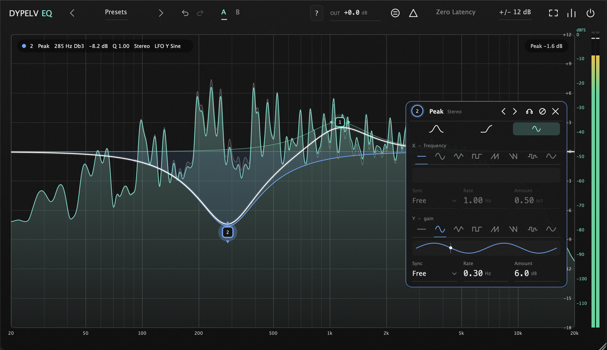
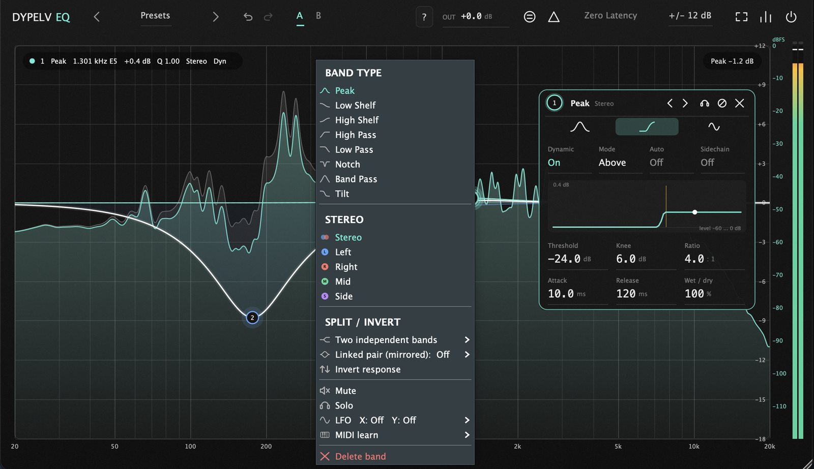

# Dypelv EQ

A free, open-source parametric equaliser for ambient and dark ambient, by Fjarg. VST3, Audio Unit and standalone.
Slow, smooth, and quiet to look at: one dark plot, round nodes, no knobs.


| Movement: LFO per band | Bands, stereo modes, dynamics |
|---|---|
|  |  |

[Download](../../releases/latest) · [Changelog](CHANGELOG.md) · [Report a bug](../../issues/new/choose)

**Status: early version (0.1.1).** Built and used on an Apple Silicon Mac. On Windows the standalone app has been tested; the VST3 has not yet been tried in a host. Expect rough edges.

## What it does

- Up to 24 bands: peak, low / high shelf, high / low pass (up to steep slopes), notch, band pass, tilt shelf
- Stereo, Left, Right, Mid or Side per band; a **linked pair** (L|R or M|S, the second side mirrored) or **two independent bands**
- Dynamic bands (compress / expand around a threshold, optional sidechain)
- Two LFOs per band (frequency, and gain or Q): sine, triangle, square, saws, random, and **Drift**, a smooth wander that never repeats. Free-running or locked to the host tempo
- Zero-latency and linear-phase modes
- Spectrum analyser with input and output curves, slope compensation, and **long averaging (5 / 15 / 60 s)** for slow material
- Solo and mute per band (S and M keys), delta listen, auto gain match, output gain
- MIDI learn on any parameter, undo / redo, A / B, presets, optional LUFS meter
- Interface scale 100 to 200 %, band colours Colour / Soft / Mono, optional film grain

## Install

### Build it yourself (macOS, recommended)

1. Install the Xcode command line tools if you do not have them (`xcode-select --install`).
2. Download this repository ("Code" -> "Download ZIP"), unzip it.
3. Double-click `Build.command`. The first build downloads JUCE and takes a while.
4. The plugins appear in the `Output` folder. Copy them:
   - `Dypelv EQ.vst3` to `~/Library/Audio/Plug-Ins/VST3/`
   - `Dypelv EQ.component` to `~/Library/Audio/Plug-Ins/Components/`

A plugin you built yourself is not blocked by macOS.

### Ready-made zip (macOS)

Download `DypelvEQ-*-mac.zip` from the Releases page, unzip, copy the files as above. The plugins are not signed with an Apple Developer certificate,
so macOS blocks a downloaded copy. Remove the block once, in Terminal:

```
xattr -dr com.apple.quarantine ~/Library/Audio/Plug-Ins/VST3/"Dypelv EQ.vst3"
xattr -dr com.apple.quarantine ~/Library/Audio/Plug-Ins/Components/"Dypelv EQ.component"
```

Then rescan plugins in your host.

### Windows

Download `DypelvEQ-Setup-*.exe` from the Releases page and run it. The installer is not code-signed, so Windows SmartScreen will warn you:
click **More info**, then **Run anyway**. It installs the VST3 to `C:\Program Files\Common Files\VST3` and the standalone app.

To build it yourself: install Visual Studio with the "Desktop development with C++" workload, CMake and Git, then run `Build.bat`.
The standalone app works; the VST3 is untested in DAWs, so reports and fixes are welcome.

## Licence

Copyright (C) 2026 Fjarg. Released under the **GNU Affero General Public Licence v3** (see `LICENSE`).
Built with [JUCE](https://juce.com), used under its AGPLv3 option.

## Feedback

Bugs, ideas and screenshots: open an issue.
